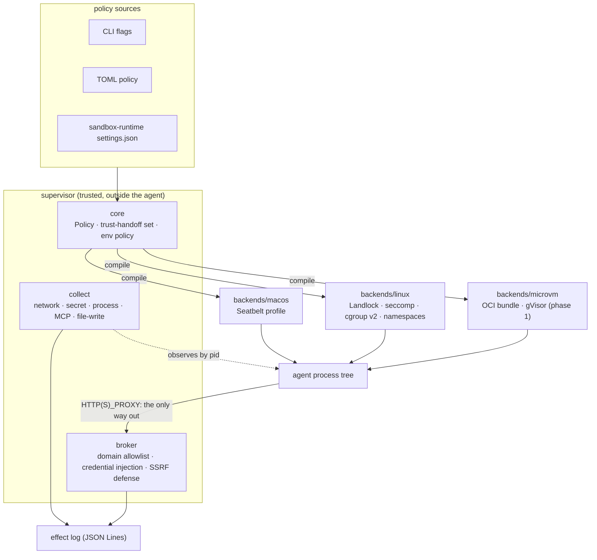

# Architecture

One idea runs through the design: **the agent is never trusted with its own
boundary.** The policy is compiled by a supervisor outside the agent and enforced
by the kernel below it, and the record of what the agent attempted is collected
from the outside too, never from what the agent reports about itself.

## The pieces



| crate | role |
|---|---|
| [`core/`](core/) | The backend-independent `Policy`, the trust-handoff set (discovered at any depth, fail-safe beyond the walk bound), the env-scrub policy, the effect-event model. New code: this is where the differentiator lives. |
| [`backends/macos`](backends/macos/) | Compiles the policy to a Seatbelt profile. Handoff paths are denied by regex, so files that don't exist yet are covered too. Base profile vendored from Codex (Apache-2.0). |
| [`backends/linux`](backends/linux/) | Landlock allow-lists carved around every deny, seccomp (UDP/raw egress, `mknod`, optional strict set), cgroup v2 caps and `cgroup.kill` teardown, and PID/mount/net namespaces. Handoff paths are pinned read-only with bind mounts where a mount namespace is available. |
| [`backends/microvm`](backends/microvm/) | Compiles the same policy to an OCI runtime bundle; phase 1 is validated against gVisor (`runsc`). See [`docs/microvm-backend.md`](docs/microvm-backend.md). |
| [`broker/`](broker/) | The one door out: a forward/CONNECT proxy limited to allowed domains, with mandatory client auth, TTL, quota, bounded workers, and per-host credential injection. |
| [`collect/`](collect/) | Collectors that attach to the agent's process tree by pid and emit effect events. |
| [`cli/`](cli/) | `tartaros run`, `explain`, `version`. |
| [`security-bench/`](security-bench/) | The conformance corpus, the runner, mutation mode, and cross-sandbox comparisons. |

## Three rules the code follows

1. **Fail closed.** If a requested protection can't be installed as a guarantee
   on this host, the run is refused or the scenario is reported `UNSUPPORTED`.
   The non-guarantees that remain are stated, warned about at launch, and listed
   in [`docs/limits.md`](docs/limits.md).
2. **Write rules grant only writes.** Reading is governed only by the read rules,
   so a writable territory can never reopen a read-denied secret inside it.
3. **Deny follows the path, not the inode it had at launch.** A handoff path stays
   protected when an ancestor directory is renamed, at any depth.

## The effect log

Every collector emits the same event, one JSON object per line:

```json
{"ts":1760000000000,"role":"dev","axis":"network","action":"connect",
 "target":"8.8.8.8:53","direction":"outside","outcome":"attempted","source":"net/proc"}
```

The format is the only contract. TartarOS doesn't know who reads it, and a reader
doesn't need to link TartarOS. Collectors observe the process tree, so they also
see what the policy allowed, which the enforcement layer never reports. The log is
for visibility and analysis; enforcement is the kernel policy. Axes, collectors and
record modes are in [`CATALOG.md`](CATALOG.md).
