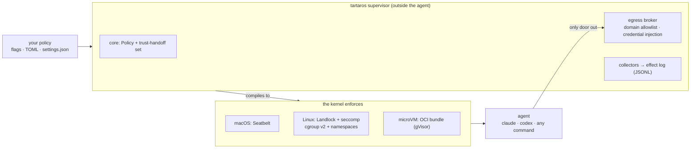
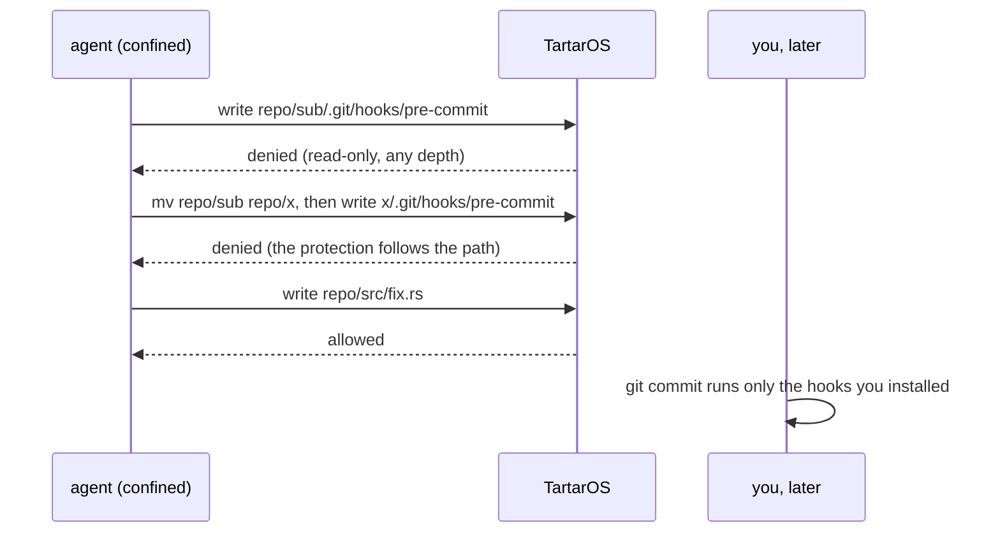

# TartarOS

**A local sandbox for AI coding agents that you can test yourself.**

Let Claude Code, Codex or any agent run unattended. Your secrets stay out of its
reach, its network stays on an allowlist, your repo stays clean, and nothing it
leaves behind runs later outside the box. Every one of those claims is a test in
this repo that you can run on your own machine.

Open source (Apache-2.0) · macOS and Linux · one binary · no Docker, no VM, no
account, no login · written in Rust · `v0.1.0-alpha`

[Website](https://carlostapiacl.github.io/tartaros/) ·
[Evidence](https://carlostapiacl.github.io/tartaros/evidence.html) ·
[Roadmap](ROADMAP.md) · [Changelog](CHANGELOG.md) · [Security](SECURITY.md)

```
tartaros run --write ./repo --read-deny ~/.ssh --read-deny ~/.aws \
  --allow-domain api.anthropic.com --allow-domain github.com \
  -- claude --dangerously-skip-permissions -p "fix the failing tests"
```

Measured on macOS: Claude Code works confined like this, with egress only to
the domains you list ([evidence](evidence/2026-10-14/macos/claude-code-allow-domain.txt)).

## What you get

**Secrets out of the agent's reach.**
- `~/.ssh`, `~/.aws`, `.env` and anything else you name are unreadable. You can
  deny a whole directory and re-open one branch inside it; the most specific rule
  wins.
- The agent's environment is scrubbed by default, so `AWS_SECRET_ACCESS_KEY` and
  `GITHUB_TOKEN` in your shell never reach it.
- The broker injects a credential per host, so the agent *uses* a token it never
  *holds* (Rust API today; the CLI flag is next on the [roadmap](ROADMAP.md)).

**Network on an allowlist, deny by default.**
- `--allow-domain` routes egress through a broker scoped to those domains, with
  SSRF defense.
- UDP, ICMP and raw sockets are closed too, so DNS tunnels and QUIC don't slip
  out.
- On Linux as root the agent gets its own network namespace whose only route is
  the broker.
- Local ports open one at a time (`--port 8080`), not all of localhost.

**Your repo stays clean.**
- No stub files, no placeholder dotfiles, no bind-mount leftovers in your working
  tree, and `git status` shows only what the agent actually wrote.
- Submodules are covered: their hooks under `.git/modules/` are protected too.

**Nothing it leaves behind runs later.**
- An agent that writes a git hook, `.claude/settings.json`, `.mcp.json` or a CI
  file doesn't escape when it writes. It escapes the next time *you* run `git
  commit` or open your editor.
- TartarOS keeps those files unwritable at any depth: nested repos, submodules,
  and paths moved by renaming an ancestor directory. That includes the sandbox's
  own config, so the agent can't switch the sandbox off.

**No silent fallback.**
- If the host can't provide a protection you asked for, TartarOS refuses to start
  or reports it `UNSUPPORTED`. It never runs you with less than you asked for and
  calls it a success.
- `tartaros explain` prints exactly what a policy grants before anything runs.

**Works where other sandboxes don't.**
- The base sandbox (Landlock and seccomp on Linux, Seatbelt on macOS) needs no
  user namespaces, no setuid helper and no Docker. It runs on hardened Ubuntu
  24.04 and inside containers.
- Root-proof process and memory caps (cgroup v2), and a timeout that reaps
  escaped daemons.
- Optional PID and network isolation.

**A log of what the agent attempted.** Every network connect, secret read,
process spawn, MCP server and file write, allowed or denied, as JSON Lines that
any tool can read (`--log effects.jsonl`).

**Already using sandbox-runtime?** `--settings settings.json` applies an existing
sandbox-runtime config. It enforces every field it can and refuses, with exit 2,
the ones it can't, instead of dropping them.

## Don't take our word for it

Each guarantee is a contract in [`security-bench/corpus/`](security-bench/corpus/):
an **attack**, a **legitimate control** that must keep working, and an
**assertion on the real effect** (the file is unchanged, the secret never shows up
in the output). A sandbox that blocks everything fails its controls.

The corpus now has 136 scenarios; 99 are derived from the public test suites of
other sandboxes (sandbox-runtime, nono, Codex, bubblewrap) and credited in
[`security-bench/SOURCES.md`](security-bench/SOURCES.md).

| run (2026-10-15) | result |
|---|---|
| Linux 6.8, Ubuntu 24.04, Landlock | **133 / 133 pass**, 0 violations |
| macOS 15.7, Seatbelt | **106 / 106 pass** (the rest are Linux-only) |
| Mutation check, both OS: remove one protection, the suite must catch it | **0 blind spots** |
| microVM phase 1 (gVisor `runsc`), the policy compiled to an OCI bundle | **20 / 20 pass** |

Scenarios still open on some host are kept in `security-bench/corpus-known-gaps/`
with their measured status, not hidden — see [Know the edges](#know-the-edges).

Raw output, host stamps and JSON reports are in
[`evidence/2026-10-14/`](evidence/2026-10-14/), and every scenario is listed on the
[evidence page](https://carlostapiacl.github.io/tartaros/evidence.html).
Reproduce it in one command:

```
./scripts/verify.sh                                         # build, tests, corpus, mutation
./scripts/verify.sh --require-caps landlock,cgroup,userns   # release gate: full Linux corpus
sudo ./scripts/corpus-runsc.sh                              # the corpus under gVisor
```

## How it works



The enforcement lives in the kernel, below the agent. The agent can't negotiate
with it, and it holds even when the agent runs as root: capabilities are dropped,
device nodes can't be created, and the caps are cgroup-enforced. The
policy model and trust-handoff logic in [`core/`](core/) are new code; the backends
reuse proven, permissively licensed plumbing (Codex's Seatbelt base,
`rust-landlock`), attributed in [`THIRD_PARTY_NOTICES.md`](THIRD_PARTY_NOTICES.md).
More in [`ARCHITECTURE.md`](ARCHITECTURE.md).



## Threat-model profiles

`--profile` picks a tier instead of hand-picking flags. Each profile states what
it guarantees, and the caveat prints on `run` and on `explain`.

| profile | adds | for |
|---|---|---|
| `local-agent` (default) | trust-handoff + network deny | a trusted agent that can make mistakes |
| `hostile-code` | + PID/mount isolation, AF_UNIX lockdown | actively malicious code on a shared kernel |
| `multi-tenant` | + egress-free network namespace | the most a single kernel can give; full tenant isolation is the [microVM backend](docs/microvm-backend.md) |

## Install

```
cargo build --release -p tartaros-cli      # target/release/tartaros
tartaros version                           # version + active backend
tartaros explain --config role.toml        # audit a policy without running it
```

On Linux you can build a fully static binary for minimal containers:

```
rustup target add x86_64-unknown-linux-musl
cargo build --release -p tartaros-cli --target x86_64-unknown-linux-musl
```

Every flag, the TOML policy format and `explain` are documented in
[`cli/README.md`](cli/README.md).

## Know the edges

A sandbox is only as trustworthy as its stated limits, so here they are, each with
the roadmap item that closes it:

- **Shared kernel.** Landlock and Seatbelt can't stop a kernel exploit. For
  untrusted code, use the microVM backend; phase 1 is validated under gVisor and
  phase 2 is Firecracker ([roadmap](ROADMAP.md)).
- **macOS teardown is best effort.** A daemon that calls `setsid()` can outlive
  the run; Linux reaps it with `cgroup.kill` (strict macOS teardown is on the
  roadmap).
- **AF_UNIX on Linux is all or nothing.** Landlock doesn't filter unix sockets by
  path, so the default profile warns when `docker.sock` or D-Bus is reachable, and
  `--deny-unix` or `hostile-code` close it. macOS filters by path.
- **Disk space.** Memory, processes and CPU are capped; bytes on disk are not yet
  (disk quota is on the roadmap).
- **Handoff files the agent creates.** Existing handoff files are protected
  everywhere at any depth, and macOS also covers files that don't exist yet.
  On Linux, under the bind-mount strategy, a handoff file created during the run is
  not, and `explain` says so ([roadmap](ROADMAP.md)).
- **The effect log is observed, not enforced.** Enforcement is the kernel policy,
  while the log samples the process tree, so a very short-lived event can be
  missed.

The full detail per OS is in [`docs/limits.md`](docs/limits.md).

## Contributing

The most valuable contribution is a **corpus scenario**: one TOML file with an
attack, a control and an effect assertion. A scenario that fails today is the best
bug report there is, and the same file runs against any sandbox, not just this one
(see [`security-bench/comparison/`](security-bench/comparison/)). Results from other
kernels and distros are welcome too. Report vulnerabilities privately, as described
in [`SECURITY.md`](SECURITY.md).

## License

Apache-2.0. See [`LICENSE`](LICENSE) and [`NOTICE`](NOTICE); reused code is
attributed in [`THIRD_PARTY_NOTICES.md`](THIRD_PARTY_NOTICES.md).

*Tartarus: the deep pit where the Titans were bound. What goes in stays in, and
here is the test that proves it.*
